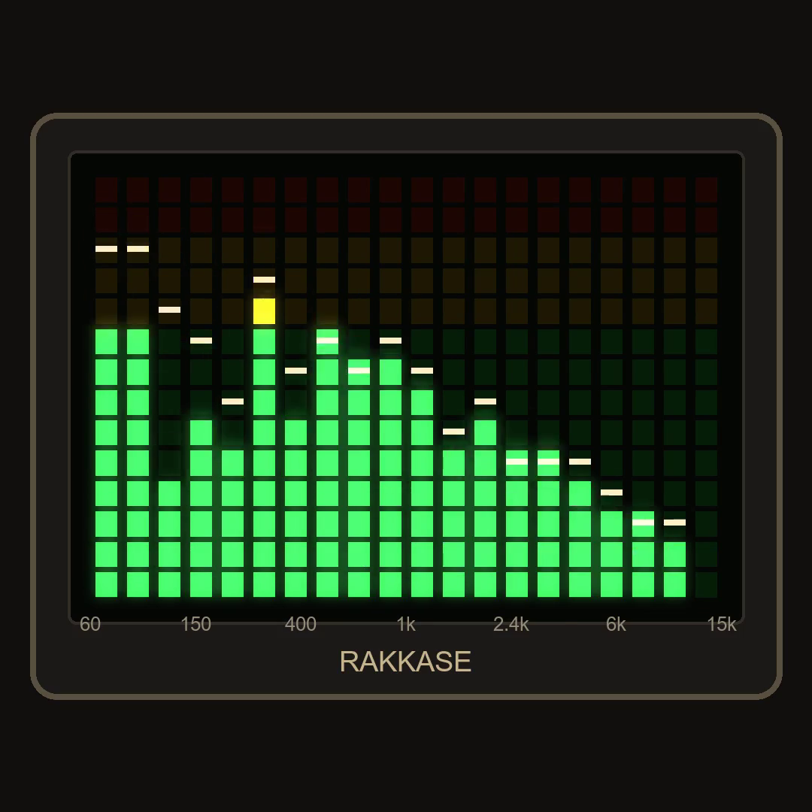

# Rakkase

<p align="center"></p>

[English](README.md) · Türkçe

Çeviri İngilizce README'yi izler; fark olursa İngilizce metin esastır, özellikle lisans metni. [`docs/`](docs/) altındaki ayrıntılı belgeler şimdilik Türkçedir.

> ACE-Step 1.5 (turbo) ile 4 GB'lık ekran kartında yerel müzik üretimi: plan dosyasını yazarsınız, Rakkase denetler, parçayı üretir ve reçetesiyle birlikte arşivler.

Rakkase, [ACE-Step 1.5](https://github.com/ace-step/ACE-Step-1.5)'in turbo modelini 4 GB VRAM'li GTX 1050 Ti'de 16 GB RAM ile sığdırıp hızlı çalıştıran ince ve dikkatli bir sarmalayıcıdır: int8 decoder, fp32 hesap, dil modeli kapalı, akışlı yükleme. Sığsın diye kaliteden ödün verilmez: 8 difüzyon adımı (modelin kendi değeri) ve fp32 sabittir. Sözlü (Türkçe dahil) ve enstrümantal parça üretir; 10 ile 600 sn arası (rahat bölge yaklaşık 300 sn'ye kadar).

**Neyi nerede ölçtük:** yalnız tek makinede (GTX 1050 Ti 4 GB, 16 GB RAM, Windows 10, 2026-11-05) [yazarlar ölçtü, `docs/OLCUMLER.md`]: model yükleme süreç başına bir kez yaklaşık 2 dk; 15 sn'lik parça yaklaşık 35-48 sn, 100 sn'lik şarkı yaklaşık 63-75 sn, 150 sn'lik düet 121 sn; RAM tepesi yaklaşık 6,4 GB. Sayılar 2026-11-05'te önceki motor metniyle ölçüldü, sonra yeniden ölçülmedi [yeniden ölçülmedi]. Başka kartlar ve 4 GB altı denenmedi; daha güçlü kartta büyük olasılıkla çalışır ama bu tahmindir [tahmin].

> **Yapay zeka ajanı (Codex, Claude Code, Gemini, Cursor) mı kullanıyorsunuz?** Ona şu cümleyi verin: "`AGENTS_HIZLI.md` dosyasını sonuna kadar oku, önce `scripts\tani.ps1` çalıştır, ilerlemeni `DURUM.md` dosyasında tut; bir şeyi silmeden ya da taşımadan, sistem Python'unu ya da PATH'i değiştirmeden veya kalite ayarını düşürmeden önce bana sor." Ajan bu bilgisayarı teşhis eder, kontrol listesi yazar ve her kararda size sorar.

**Yapay zeka kodlama ajanıyla (Claude Code, Codex, Gemini CLI, Copilot, Cursor...) kuruyorsanız [`AGENTS.md`](AGENTS.md)'den başlayın** (hızlı kart: [`AGENTS_HIZLI.md`](AGENTS_HIZLI.md)). git, uv ve Python'u bir kez siz kurarsınız; "evet" dedikten sonra gerisini ajan yürütür.

**Başlamadan önce:**
- Windows 10/11 ve **4 GB ya da üstü NVIDIA kart** (yalnız GTX 1050 Ti'de denendi; NVIDIA kart yoksa, macOS ya da Linux'ta henüz çalışmaz).
- Yaklaşık **25 GiB boş disk** (modeller 6,4 GB; kurulumun tamamı yaklaşık 23 GB).
- **git, uv ve Python 3**'ü siz kurarsınız (`winget install --id Git.Git -e`, `winget install --id=astral-sh.uv -e`, `winget install --id Python.Python.3.12 -e`), sonra yeni terminal açın; Microsoft Store "python" takma adı Python değildir.

## Hızlı başlangıç (Quick start)

1. **Makinenizi kontrol edin:** Windows 10/11 [ölçtüm: Windows 10], 4 GB ya da üstü NVIDIA kart [yalnız GTX 1050 Ti'de denendi], 16 GB RAM, yaklaşık 6,4 GB model (22 dosya) için boş disk [okudum: `scripts/modeller.json`] ve torch'lu Python ortamı; kurulumun tamamı yaklaşık 23 GB (denetim ~25 GiB boş yer ister) [ölçtüm: temiz kurulumda yaklaşık 23 GB, modeller yerel kaynaktan kopyalandı]. Önce **git** ve **uv**'yi kurun (sizin için kurulmaz): `winget install --id Git.Git -e` ve `winget install --id=astral-sh.uv -e`, sonra yeni bir terminal açın. ffmpeg isteğe bağlı (yoksa wav alırsınız, mp3 olmaz): `winget install --id Gyan.FFmpeg -e`.
2. **Bu depoyu indirip açın** (yeşil **Code** düğmesi, **Download ZIP**): boşluksuz ve Türkçe harfsiz KISA bir klasöre, örneğin bir sürücünün en üstünde `rk` adlı bir klasöre. İnternetten inen dosya için Windows SmartScreen uyarısı çıkabilir: önce `scripts\kur.ps1`'i okuyun (düz metin betiktir), sonra karar verin. Yönetici olarak çalıştırmayın (gerekmez).
3. **`kur.cmd`'ye çift tıklayın.** git, uv, sürücü, disk ve VRAM'i denetler, [ACE-Step 1.5](https://github.com/ACE-Step/ACE-Step-1.5)'i denediğimiz commit'te kurar, model dosyalarını indirir (yaklaşık 6,4 GB, yalnız `huggingface.co/ACE-Step` ve `huggingface.co/Qwen`'den, sha256 ile denetlenir) ve `ayarlar.json`'u sizin için yazar. Süre bağlantınıza ve diskinize bağlıdır [ölçülmedi]. Yarım kalan çalışma kaldığı yerden sürer: yeniden çalıştırın. Önce planı görmek için terminalde `kur.cmd -Kuru`: neyi yapacağının raporunu yazar ve hiçbir şey yazmaz: dosya, klasör, ağ yok [bakımcılar kopya klasörde ölçtü]. ACE-Step klasörünüz zaten varsa `kur.cmd` bulur, yeniden kurmaz.
4. **`uret.cmd`'ye çift tıklayın:** en güvenli örneği üretir (`ornekler/sozsuz_fon_ninni.json`, sözsüz); kendi parçanız için bir `plan.json`'u `uret.cmd`'nin üzerine sürükleyin. Parça `uretimler/<tarih_saat>_<ad>/` altına wav + mp3 ve reçete dosyasıyla düşer. GTX 1050 Ti'mizde yaklaşık 2 dk model yükleme ve parça süresinin 0,6-0,8 katı [yazarlar ölçtü, `docs/OLCUMLER.md`]; varsayılan örnek (96 sn) kabaca 3 dk sürer [bu sayılardan türetildi, olduğu gibi koşulmadı].
5. **Kurulumunuzu kanıtlayın (GPU):** `python rakkase.py test` 15 sn'lik bir referans üretir ve depodaki referans wav ile kıyaslar (geçer: korelasyon > 0,999 ve SNR > 40 dB; çıkış 0 = geçti, 1 = kaldı).

Bir şey ters giderse betik `HATA: [RK-E-...]` basar: kodu [`docs/SIK_HATALAR.md`](docs/SIK_HATALAR.md)'de arayın (her kod için tek ilk adım). Hata bildirmek için `powershell -NoProfile -ExecutionPolicy Bypass -File scripts\tani.ps1 -Cikti tani_raporu.txt` çalıştırın (yollarınızı ve kullanıcı adınızı maskeler; yine de dosyayı yapıştırmadan önce okuyun). Betiksiz elle kurulum: [`KURULUM.md`](KURULUM.md).

Durum: temiz bir klasörde taze uv ortamıyla tam kurulum 32 dk 6 sn’de (uv paket indirme 13 dk 50 sn, paket kurulumu 3 dk 34 sn, modeller yaklaşık 14 dk) HAZIR oldu, ardından GPU’da `rakkase.py test` geçti (SNR 44,1 dB, korelasyon 0,999988, 539 sn, VRAM tepe 2653 MB, RAM tepe 7688 MB) [ölçtüm: bakımcılar, 2026-11-22, modeller yerel kopyadan alındı; HuggingFace indirmesinin kendisi ve git/uv’siz gerçekten boş makine henüz doğrulanmadı]; takılırsanız hata bildirimi açın, adımları düzeltmemize yarar. GPU'nuz ya da ACE-Step kurulumunuz yoksa beş dakikada hiçbir şey çalışmaz: belgeleri okuyun, plan ya da çeviri düzeltmesi gönderin (`CONTRIBUTING.md`), 3. adımdan sonra dönün.

```
python rakkase.py denetle --plan P.json   # plan denetimi, CPU, birkaç sn, modeli yüklemez
python rakkase.py uret    --plan P.json   # önce denetler, sonra üretir ve arşivler
python rakkase.py bol     --plan P.json   # uzun planı yaklaşık 300 sn'lik koşulara böler
python rakkase.py test                    # motor değişince referansla kıyas
python rakkase.py mp3     <klasör>        # her wav'ın yanına mp3 192k
```

## Disk düzeni ve kaldırma
Rakkase'in kurduğu her şey tek kök klasörde, `<ACE_KOK>` altında durur (varsayılan `<repo>\ace_step`; `kur.cmd -AceKok <klasör>` ile değişir, ör. daha boş bir sürücüye). Sistem PATH'ine, kullanıcı profiline ve registry'ye hiçbir şey yazılmaz. `ayarlar.json` (ayarlarınız) `rakkase.py`'nin yanında kalır.

| `<ACE_KOK>` altındaki klasör | İçinde ne var | Boyut |
|---|---|---|
| `checkpoints` | model dosyaları (`huggingface.co/ACE-Step` ve `/Qwen`'den 22 dosya, sha256 denetimli) | yaklaşık 6,4 GB [okudum: `scripts/modeller.json`] |
| `.venv` | Python ortamı (uv, torch 2.7.1+cu128) | yaklaşık 23 GB toplamın büyük kısmı [ölçtüm: bir temiz kurulum, toplam] |
| `.onbellek\uv` | uv indirme önbelleği | aynı toplamın parçası [ayrı ölçülmedi] |
| `.onbellek\uv-python`, `.onbellek\uv-bin` | uv'nin kendi Python 3.11'i ve başlatıcı kısayolları; yalnız uygun bir Python 3.11 bulunamazsa oluşur | aynı toplamın parçası [ayrı ölçülmedi] |
| `gecici` | kurulumun geçici dosyaları | küçük [ölçülmedi] |

Yalnız kurulum betiğinin kendi süreci için `UV_CACHE_DIR`, `TMP` ve `TEMP` bu köke yönlenir (uv kendi Python'unu kurmak zorundaysa `UV_PYTHON_INSTALL_DIR` ve `UV_PYTHON_BIN_DIR` de; `.venv` zaten varsa hiçbir şey değişmez; `UV_` değişkenlerinden birini kendiniz tanımladıysanız ona dokunulmaz ve o kullanılır; `TMP` ve `TEMP` her zaman köke gider); böylece uv kullanıcı profilinizi ya da sistem sürücüsünü doldurmaz. Hugging Face ve torch önbellekleri kullanılmaz (Rakkase kendi sabitlenmiş indiricisini kullanır).

**Modeli zaten indirdiniz mi?** Klasörü `kur.cmd -AceKok` ile gösterin; sha256'sı doğru tam dosya atlanır, yeniden indirilmez. Yarım kalan indirme `.part` dosyasından sürer.

**Kaldırma:** Rakkase'i kapatın, sonra Rakkase klasörünü ve `<ACE_KOK>` klasörünü silin (varsayılanda ikisi aynı klasördür, çünkü `<ACE_KOK>` depo klasörünün içindedir). Kaldırma bu kadar. Bizim silmemiz gerekmeyenler: kurulumdan ÖNCE var olan pip ya da uv önbellekleri ve `winget` ile kurulan git, uv, Python (`pip cache purge`, `uv cache clean` ya da Windows "Uygulamalar" ile siz silersiniz). Ürettiğiniz parçalar `uretimler/` içindedir: silmeden önce kopyalayın.

## Örnek planlar

| Dosya | Ne | Not |
|---|---|---|
| `ornekler/sozsuz_fon_ninni.json` | 96 sn enstrümantal ninni (gitar, çello, klarnet) | sözsüz: ilk deneme için en güvenlisi |
| `ornekler/rap_claude_code_40sn.json` | 40 sn Türkçe rap, özgün söz | tek parça, kısa; addaki "Claude" örnek sözlerde geçen bir ürün adıdır |
| `ornekler/sozlu_balad.json` | 100 sn Türkçe balad, özgün söz | sözlü, tek parça |
| `ornekler/cesit_6_tarz.json` | altı tarz (düet, koro, halk, rap, oryantal, çocuk) | yaklaşık 10 dk ses: sonraya |

Plan bir JSON'dur: `caption` (İngilizce tarz tarifi, 256 token sınırı), `[Verse]`/`[Chorus]` etiketli `lyrics`, `sure` (sn), `bpm`, `ton`, `olcu`, `tohum` (aynı plan + aynı tohum = aynı parça). Her alan [`docs/KULLANIM.md`](docs/KULLANIM.md)'de, sınırlar [`docs/SINIRLAR.md`](docs/SINIRLAR.md)'de, işe yarayan tarifler [`docs/TARIFLER.md`](docs/TARIFLER.md)'de.

## Tohum (üç tane deneyin)
Tohum (plandaki `tohum`), rastgeleliğin başlangıç sayısıdır. Aynı plan ve aynı tohum aynı parçayı verir; aynı tarif farklı tohumla aynı şarkının başka bir yorumunu verir, yani tek fikir birkaç şarkı olabilir. Yakın sayılar (41 ve 42) benzer sonuç vermez: birbirinden uzak sayılar seçin. `ornekler/tohum_denemesi.json` ile üç tohum deneyin, dinleyin, beğendiğinizi seçin. Her tohum tam üretim süresi kadar sürer (parça süresinin yaklaşık 0,6-0,8 katı); tohum yaratıcı bir seçimdir, kalite ayarı değildir. Ayrıntı: [`docs/KULLANIM.md`](docs/KULLANIM.md) ("Tohum denemesi"). Yapay zeka ajanlarına bunu ilk parçadan önce size anlatmaları söylenmiştir.

## Paylaşmaya hazır panel videosu
X, Instagram ve WhatsApp düz ses dosyası kabul etmiyor. Bu yüzden her `uret` sonrasında Rakkase parçanın yanına `<ad>_panel.mp4` de yapar: müzikle oynayan, eski radyo tarzı LED spektrumlu 1080x1080 bir video; ses kayıpsız kaynaktan AAC 320k olarak içinde. 100 sn'lik bir parçada CPU'da 49 sn sürdü ve 8,5 MB çıktı [bakımcılar ölçtü, tek koşu; başka makinelerde ölçülmedi]. Panel parçanın gerçek spektrumunu gösterir; müziği değiştirmez. ffmpeg ister (mp3'ün kullandığı aynısı; numpy, soundfile ve Pillow ACE-Step ortamında zaten var). ffmpeg yoksa parça ve mp3 yine yapılır, panel uyarıyla atlanır; `uret` sırasında panel düşerse yalnız uyarı alırsınız, çıkış kodu değişmez. `--panel-yok` ile kapatın, sonradan `python rakkase.py panel <wav ya da klasör>` ile yapın. Ayrıntı: [`docs/KULLANIM.md`](docs/KULLANIM.md) ("Paylaşmaya hazır panel"). Paylaştığınız şey için aynı telif notu geçerli: sanatçı adı yok, başkasının sözü yok.

[](docs/gorsel/ornek_panel.mp4)

Resme tıklayın, 20 saniyelik örnek oynar (Rakkase'nin kendi ürettiği halk tarzı bir Türkçe parçadan kesit; sesi model söylüyor, ses klonu yok).

## Bir şey ters giderse
Önce [`docs/SORUN_GIDERME.md`](docs/SORUN_GIDERME.md) (ne görürsünüz, ne yapılır) ve [`docs/HATALAR.md`](docs/HATALAR.md) (15 sık hata, 7 yanlış inanç). `rakkase.py uret` çıkış kodları: 0 tamam, 2 plan denetiminde hata ya da motor başlamadı, 3 bir parça başarısız, 4 RAM bekçisi durdurdu, 5 üretim tamam ama arşiv başarısız, 6 `ayarlar.json` eksik ya da yanlış.

## Klasörler

| Yer | İçerik |
|---|---|
| `rakkase.py` | tek giriş kapısı (uret, denetle, bol, test, mp3) |
| `motor/` | üretim motoru (ACE-Step sarmaları, ölçüm) ve venv başlatıcı |
| `araclar/` | plan denetimi, reçete arşivi, wav kıyası, ses seviyesi, bellek izleyici |
| `ornekler/` | örnek planlar (her biri `docs/TARIFLER.md`'de anlatılır) |
| `testler/` | kıyas planı, referans wav (kendi ACE-Step çıktımız), CPU testi |
| `docs/` | belgeler (şimdilik Türkçe) |
| `ayarlar.json` | yerel yollarınız (git dışı; `ayarlar.ornek.json`'dan kopya) |

## Katkı, destek, güvenlik
[`CONTRIBUTING.md`](CONTRIBUTING.md) (ilk PR 5 adımda), [`AGENTS.md`](AGENTS.md) (yapay zeka ajanları için), [`SUPPORT.md`](SUPPORT.md) (hedef, garanti değil), [`SECURITY.md`](SECURITY.md) (açıkları GitHub'ın "Report a vulnerability" bağlantısıyla gizli bildirin; herkese açık issue açmayın), [`PRIVACY.md`](PRIVACY.md) (telemetri yok), [`CODE_OF_CONDUCT.md`](CODE_OF_CONDUCT.md).

## Lisans ve atıf

- Rakkase kodu ve belgeleri: MIT, bkz. [`LICENSE`](LICENSE). Üçüncü taraf bildirimleri: [`NOTICE`](NOTICE).
- ACE-Step 1.5 kodu: MIT (https://github.com/ace-step/ACE-Step-1.5). Model ağırlıkları: MIT; model kartı üretilen müziğin ticari kullanılabileceğini söyler (https://huggingface.co/ACE-Step/Ace-Step1.5; geliştirici beyanıdır, bağımsız garanti değil).
- Metin kodlayıcı Qwen3-Embedding-0.6B: Apache-2.0 (https://huggingface.co/Qwen/Qwen3-Embedding-0.6B).
- Ağırlıklar bu depoda yok; kurulumda resmî kaynaktan indirilir. Üretilen müzikte üslup benzerliği ve korumalı malzeme kullanımının sorumluluğu sizdedir (ACE-Step README'sindeki gibi): planlarda sanatçı adı ve başkasının sözü kullanmayın. Ayrıntı: `docs/HATALAR.md` (yanlış Y7: müzik hakları).
